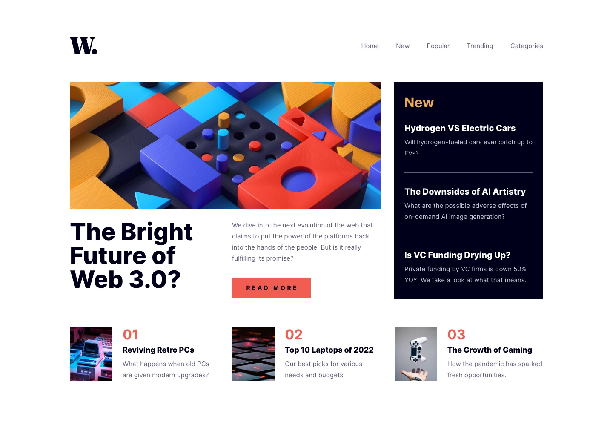

# Frontend Mentor - News homepage solution

This is a solution to the [News homepage challenge on Frontend Mentor](https://www.frontendmentor.io/challenges/news-homepage-H6SWTa1MFl).



## The challenge

Users should be able to:

- View the optimal layout for the interface depending on their device's screen size
- See hover and focus states for all interactive elements on the page

## Built with

- [Next.js 16](https://nextjs.org/) (App Router, static export)
- [React 19](https://react.dev/)
- [Tailwind CSS 4](https://tailwindcss.com/), with design tokens from the Figma file defined in `@theme`
- TypeScript
- Semantic HTML, CSS Grid and Flexbox, mobile-first

## Highlights

- Three layouts (mobile, tablet and desktop) that follow the Figma spacing and type scale, with no horizontal scrolling down to 320px.
- The hero uses `<picture>` art direction, so each viewport downloads only the image it shows.
- The mobile and tablet menu is a native modal `<dialog>`: focus moves into the menu and returns to the toggle on close, page scrolling is locked while it is open, and Escape, the close button or a click on the backdrop all close it.
- Every interactive element has a hover state and a visible `:focus-visible` outline.

## Development

Requires Node.js 22+ and pnpm.

```bash
pnpm install
pnpm dev        # http://localhost:3000/fem-news-homepage
pnpm lint
pnpm typecheck
pnpm build      # static site in out/
```

Pushing to `main` builds the site and deploys `out/` to GitHub Pages (`.github/workflows/deploy.yml`).
